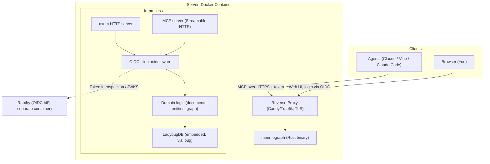
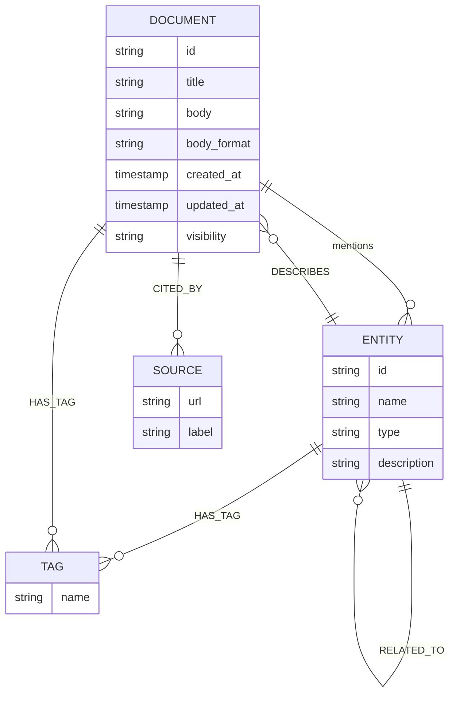

# Plan: Rust Wiki &amp; Agent Memory with LadybugDB

> **Superseded in part by [`mnemograph-v1.md`](mnemograph-v1.md) (2026-10-18).** Where they disagree, v1 wins: pages and entities are unified (ADR 0001), agents use authorization code with pre-registered clients instead of client credentials (ADR 0002), and storage is SQLite + Tantivy instead of LadybugDB (ADR 0003). This document is kept for its background and deferred ideas.

**Project name:** `mnemograph`  
**Goal:** A lean, self-hosted knowledge base for personal AI projects — serving as a human-readable wiki *and* a machine-readable agent memory in a single binary.

## 1. Vision &amp; Design Principles

- **One Rust binary** contains the HTTP server, wiki UI, agent API (MCP), and the embedded graph database (LadybugDB, via the `lbug` crate). No separate DB process, no external dependencies except Rauthy as the OIDC IdP.
- **Documents + Graph:** Content is stored as documents (full text, formatting), while entities and relationships are maintained as a graph. Both views operate on the same data.
- **Agent-first:** The primary usage pattern is access by agents (Claude, Vibe, local coding agents) via MCP; the web UI is for you to browse, curate, and correct.
- **Private by default:** Authentication via Rauthy (OIDC), no public write access, all data stays on your own server.
- **Deliberately simple:** No feature clone of Notion/Outline. Formatting via a small, extended Markdown dialect (see §4).

## 2. Architecture



**Key building blocks:**


| Component                    | Technology                                                                | Rationale                                                                             |
| ---------------------------- | ------------------------------------------------------------------------- | ------------------------------------------------------------------------------------- |
| HTTP framework               | `axum`                                                                    | Widely used, excellent ecosystem (tower middleware), fits MCP Streamable HTTP         |
| Graph DB                     | LadybugDB via `lbug` crate                                                | Embedded, Cypher, FTS + vector indices included, Rust bindings                        |
| MCP server                   | `rmcp` (official Rust MCP SDK)                                            | Streamable HTTP transport, a single `/mcp` endpoint next to the web UI                |
| Auth                         | `openidconnect` crate + Rauthy                                            | Standard OIDC; agents get client-credentials tokens, browser users get the login flow |
| Full-text search             | LadybugDB FTS extension                                                   | One engine for everything — no second search infrastructure                           |
| Embeddings (optional, later) | LadybugDB vector extension + local embedding model (e.g. via `fastembed`) | Semantic search without external APIs                                                 |
| Frontend                     | Server-side rendered (askama) + htmx                                      | Minimal footprint, no SPA build pipeline                                              |


## 3. Data Model (Graph)

Node and edge types as a starter set — deliberately small, extensible via migrations:



- **ENTITY types (initial):** `project`, `technology`, `decision`, `note`, `person`, `tool`, `concept`
- **Relations:** `RELATED_TO` (generic, with a `relation` property for semantics, e.g. `uses`, `depends_on`, `decided_against`), `MENTIONS` (extracted automatically from documents), `DESCRIBES`
- **Extraction:** When a document is saved, the domain logic suggests entities (string matching on existing names + heuristics if needed); explicit references via `[[EntityName]]` syntax. Fully automated LLM extraction as an optional later step (then as a background job with a configurable local/external model).

## 4. Document Format

Not plain Markdown, but a small extension ("mnemograph-flavored"):

- Markdown base (Comrak renderer)
- `[[Wikilinks]]` → resolve to entities/documents, create `MENTIONS` edges
- `[[Entity|relation]]` → a typed relationship instead of a generic link
- Frontmatter (YAML): `title`, `tags`, `visibility`, `entity_types`
- Callouts (`> [!note]`, `> [!decision]`) for structured notes
- Mermaid code blocks are rendered
- Tables, task lists, footnotes via Comrak extensions

This keeps the format git-friendly and trivial for agents to write, while adding wiki-typical structure.

## 5. API Design

### 5.1 MCP Tools (for agents, `/mcp` endpoint)


| Tool            | Description                                                                                             |
| --------------- | ------------------------------------------------------------------------------------------------------- |
| `search_wiki`   | Full-text search (FTS), optionally filtered by tags/entity type                                         |
| `read_page`     | Document by ID/slug including metadata and outgoing links                                               |
| `write_page`    | Create/update a document (agent writes mnemograph-flavored MD)                                          |
| `list_entities` | Entities by type, tag, recency                                                                          |
| `get_entity`    | Entity + its relationships (n-hop traversal)                                                            |
| `query_graph`   | Restricted Cypher access to a whitelist of read-only query templates (no free-form Cypher from agents!) |
| `add_relation`  | Create an explicit edge between two entities                                                            |
| `find_related`  | "What else do I know about topic X" — combining FTS + graph neighborhood                                |
| `remember_this` | Save a summary as a note (lightweight entry point for agents)                                           |


**Security principle:** Writing tools validate strictly and are sandboxed (e.g. no deletions by agents — deletion only via the web UI, by you). The agent is the *curator of knowledge*, not the owner.

### 5.2 HTTP Routes (Web UI)

- `GET /` — Dashboard: recently changed, open questions
- `GET|POST /pages/:slug`, `GET /pages/new` — Read/edit
- `GET /graph` — interactive graph view (vis.js/sigma.js, served statically)
- `GET /search?q=` — Search
- CRUD for entities, tag filters
- Admin: trigger backups, manage agent tokens

## 6. Authentication &amp; Multi-Access

- **Human (browser):** OIDC Authorization Code Flow against Rauthy. Session as a cookie (axum-session).
- **Agents:** A dedicated OIDC client in Rauthy with Client Credentials Flow → Bearer token for the MCP endpoint. One separate client per agent (`agent-claude`, `agent-vibe`, `agent-local`), so you can revoke them individually if needed. Short-lived tokens; local JWT validation via Rauthy's JWKS (no round trip per request).
- **Ground rule for external agent access:** MCP endpoint only via TLS through the reverse proxy; optionally IP restrictions or VPN-only for the local coding agent.

## 7. Project Structure (Cargo Workspace)

```
mnemograph/
├── Cargo.toml            # workspace
├── crates/
│   ├── mnemograph-core/    # Domain: documents, entities, graph logic, extraction
│   ├── mnemograph-store/   # LadybugDB adapter: schema, migrations, query helpers
│   ├── mnemograph-mcp/     # MCP tools based on mnemograph-core
│   └── mnemograph-web/     # axum + askama + htmx, OIDC middleware; binary
├── migrations/           # Cypher schema migrations
└── docker/
    ├── Dockerfile        # Multi-stage: rust:slim + C++ toolchain → distroless/debian-slim
    └── docker-compose.yml # mnemograph + rauthy + caddy (reference stack)
```

**Crate choices in detail:**

- `axum`, `tokio`, `tower` — HTTP stack
- `askama` — HTML templates, compile-time checked
- `comrak` — Markdown/extensions
- `lbug` (LadybugDB Rust bindings) — graph + FTS + vector
- `rmcp` — MCP server (official Rust SDK)
- `openidconnect`, `jsonwebtoken` — OIDC + JWT
- `axum-extra` (cookie sessions), `serde`, `tracing` + `tracing-subscriber`

## 8. Implementation Plan (Phases)

**Phase 0 — Setup (half a day)**  
Set up the Cargo workspace, CI (GitHub Actions or Gitea Actions: fmt, clippy, test), Dockerfile skeleton. First milestone: the binary starts, health-check route, LadybugDB opens a DB file in-process.

**Phase 1 — Core without auth (1–2 weekends)**  
Document CRUD in memory/persistence via LadybugDB, Comrak rendering, wikilink resolution, FTS search. Milestone: you can locally create, link, and search pages.

**Phase 2 — Graph (1 weekend)**  
Entity/relation schema, extraction from wikilinks, simple graph view in the web UI. Milestone: `[[Rust]]` automatically creates a `Rust` entity with a relationship to the document.

**Phase 3 — MCP server (1 weekend)**  
Integrate `rmcp`, implement `search_wiki`, `read_page`, `write_page`, `find_related`, test locally with Claude Code as the client. Milestone: an agent can read and write.

**Phase 4 — Auth &amp; deployment (1–2 weekends)**  
Rauthy Docker stack, OIDC login, agent clients with client credentials, reverse proxy TLS termination, Hetzner deployment (CX22). Milestone: production server running, first external agent (Claude custom connector) connected.

**Phase 5 — Polish (ongoing)**  
Vector/semantic search, `remember_this` improvements, graph visualization, backup job (nightly export as Cypher + markdown mirror for portability), check Vibe integration.

## 9. Open Points / Decisions

1. **Vibe integration:** Vibe needs an MCP connector — check whether Rauthy client credentials + MCP URL can be configured as a custom connector, or whether a gateway (e.g. an MCP proxy) is required.
2. **Extraction:** Start wikilink-based only, or go straight to LLM-backed entity extraction on save? Recommendation: wikilinks first (deterministic, cheap), LLM extraction as an enhancement.
3. **Markdown mirror:** Should there be a git export of the documents (portability, version history outside the DB)? Recommendation: yes, as an optional background export.
4. **Wiki vs. running Outline:** If the editor turns out to be too rudimentary along the way — keep mnemograph as agent memory and run an Outline in parallel for "pretty" documents? The graph layer is the differentiator; you can decide later.

## 10. Risk Check

- **LadybugDB project health:** Most active community fork; export as Cypher/Parquet possible — data is not trapped in the binary.
- **C++ toolchain in the Docker build:** Multi-stage build keeps the runtime image small (\~50–100 MB).
- **MCP protocol evolution:** `rmcp` as the official SDK mitigates breaking-change risk; keep the tool surface small.
